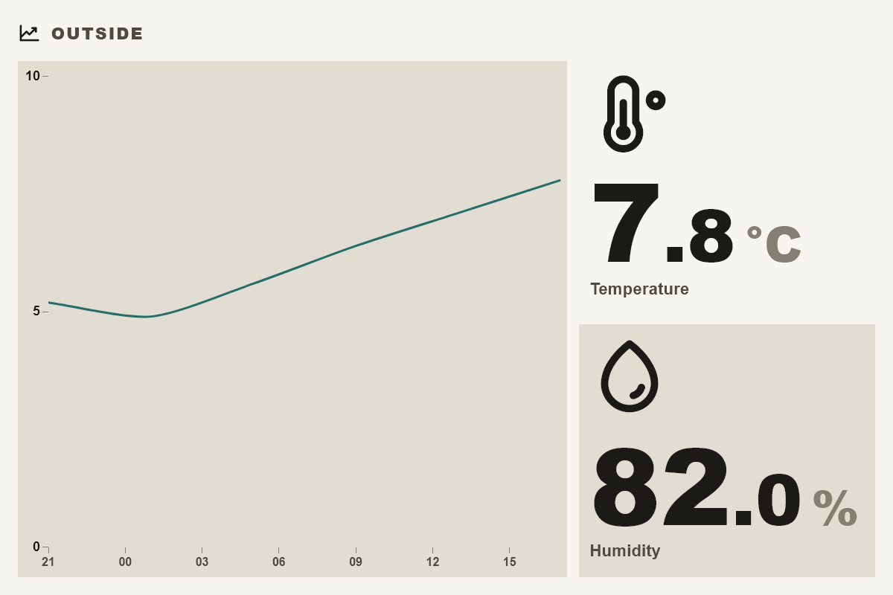

# ha_dual_history

A Tesserae widget that draws the history graph of one Home Assistant entity
beside its current value and, optionally, the current value of a second entity.
A typical use is an outdoor tile: temperature history plus current temperature
and humidity.

## What it does

- Reads current states and the primary entity's history through the shared
  Home Assistant Core plugin (`ha_core`); the widget makes no requests of its own.
- History window from 6 hours to 7 days, drawn on a real time axis with
  local-hour ticks (weekdays for 3 and 7 days).
- Labels, icons and units follow the entity's `device_class` unless set
  manually; numbers are formatted for the display locale.
- An unavailable entity shows a dash; a failed history request shows an error
  in the graph area only, the current values stay.
- Sizes `xs`–`lg`: graph and values side by side in wide cells, graph above the
  values in compact ones.

## Setup

Configure the bundled **Home Assistant Core** plugin (Settings → Widgets →
Home Assistant Core) with your Home Assistant URL and a Long-Lived Access Token.
This widget adds no settings of its own.

## Cell options

| Option | Values |
| --- | --- |
| Title, Title size | blank = the primary entity's name; 0.5–3× |
| Primary entity | the entity whose history is drawn and whose value is shown |
| Secondary entity | optional; only its current value is shown |
| Label, Show label, Number format, Icon | per value; blank label and `Auto` icon follow `device_class`; format `0`, `0.0`, `0.00` |
| Values position | `right` or `left` (wide sizes) |
| Graph size | 40–80 % of the body |
| History window | 6, 12, 24 hours, 2, 3 or 7 days |
| Minimum Y-axis span | widens a flat graph without clipping values |

## Locales

English, Russian, Ukrainian.

## Notes

- No `requires` block: all Home Assistant traffic goes through the
  `ha_core` connection, whose host is configured per installation.

## License

AGPL-3.0-or-later, see [LICENSE](LICENSE).
